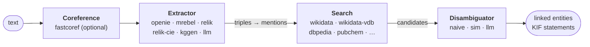

<h1 align="center">KBEL</h1>

<p align="center">
  <b>Knowledge Base Entity Linking</b><br>
  Link text to Wikidata (and other knowledge bases), from a single mention to a whole document.
</p>

<p align="center">
  
  
  
</p>

KBEL is a Python framework that turns text into knowledge-base entities. It
works at two levels:

- **Entity linking.** Given a term and the sentence it appears in, find the
  entity it refers to: *"Python"* in *"Python is a programming language"* is
  `wd:Q28865`, not the snake.
- **Knowledge graph construction.** Extract subject–predicate–object triples
  from free text and link each part to an item or a property, producing
  [KIF](https://github.com/PUC-Behring-Institute-for-AI/kif) statements.

Every stage is a plugin chosen by name, so extraction, search and
disambiguation strategies combine freely:



**Highlights**

- 7 triple extractors, 3 disambiguators, a coreference stage and every KIF
  search backend, all interchangeable.
- `construct`: a lazy, concurrent text → statements pipeline that links each
  mention with its sentence *and* its paragraph as context.
- Every statement KIF can express: items, properties and literal values
  (dates, quantities, strings, texts, URLs, external ids) chosen by the
  property's datatype, and some-value / no-value snaks.
- Iterators for every multi-item process (`extract`, `extract_and_link`,
  `link_many`, `construct`): results arrive as they are ready, in order, and
  stopping early cancels the rest.
- Sync and async versions of every operation; usable inside Jupyter.
- Resilient searches: rate limits and network errors are retried with
  backoff.
- An evaluation suite (T-REx and DocRED) with resumable runs, per-stage
  timing, full call traces and an error diagnosis for every triple.

## Contents

- [Installation](#installation)
- [Quick start](#quick-start)
- [What you can do](#what-you-can-do)
  - [Look up candidates](#look-up-candidates)
  - [Link a mention](#link-a-mention)
  - [Extract triples](#extract-triples)
  - [Extract and link](#extract-and-link)
  - [Resolve coreferences](#resolve-coreferences)
  - [Build statements from a document](#build-statements-from-a-document)
  - [Iterators](#iterators)
  - [Async API](#async-api)
- [Components](#components)
  - [Knowledge bases](#knowledge-bases)
  - [Disambiguators](#disambiguators)
  - [Coreference resolvers](#coreference-resolvers)
  - [Triple extractors](#triple-extractors)
  - [Using LLMs](#using-llms)
- [Data model](#data-model)
- [Extending KBEL](#extending-kbel)
- [Evaluation](#evaluation)
- [Development](#development)
- [Limitations](#limitations)
- [License](#license)

## Installation

KBEL requires Python 3.11–3.13.

```bash
pip install "kbel @ git+https://github.com/lapic-ufjf/kbel.git"
```

The base install has the `naive` disambiguator and all knowledge bases.
Everything else is an extra, so you only install what you use:

| Extra | Enables | Needs |
|-------|---------|-------|
| `similarity` | `sim` disambiguator | sentence-transformers |
| `coreference` | `fastcoref` coreference resolver | fastcoref, spaCy (the model, ~500 MB, is downloaded on first use) |
| `llm` | `llm` disambiguator and `llm` extractor | LangChain (OpenAI-compatible APIs, Ollama) |
| `mrebel` | `mrebel` extractor | PyTorch, Transformers |
| `openie` | `openie` extractor | Java; CoreNLP (~500 MB) is downloaded on first use |
| `relik` | `relik` and `relik-cie` extractors | a Python 3.10 or 3.11 interpreter; ReLiK is installed in its own environment on first use |
| `kggen` | `kggen` and `kggen-cluster` extractors | kg-gen (DSPy, LiteLLM) |
| `evaluation` | the results notebook | pandas, matplotlib, jupyter |
| `dev` | tests and tooling | pytest, ruff, … |

```bash
pip install "kbel[similarity,llm,mrebel] @ git+https://github.com/lapic-ufjf/kbel.git"
```

A missing optional dependency raises an `ImportError` that names the extra
to install.

## Quick start

Link a mention:

```python
from kbel import KBEL, Mention

kbel = KBEL('wikidata', disambiguator='naive')

mention = Mention(term='Python', text='Python is a programming language created by Guido van Rossum.')
for result in kbel.link(mention, limit=1):
    print(result.entity, result.candidate.label, '-', result.candidate.description)
# Item(IRI('http://www.wikidata.org/entity/Q28865')) Python - general-purpose programming language
```

Turn a text into knowledge-base statements:

```python
kbel = KBEL('wikidata', disambiguator='sim', extractor='mrebel')

for statement in kbel.construct('Alan Turing was born on 23 June 1912 in London.'):
    print(statement)
# Statement(Item(wd:Q7251), ValueSnak(Property(wd:P569, TimeDatatype()), Time(1912-06-23, DAY)))
# Statement(Item(wd:Q7251), ValueSnak(Property(wd:P19, ItemDatatype()), Item(wd:Q84)))
```

Each result is a KIF [`Statement`](https://github.com/PUC-Behring-AI/kif):
the value is an item (*London*) or a literal (*23 June 1912* became a
`Time`), depending on the property. See
[Build statements from a document](#build-statements-from-a-document).

Plugins are referred to by name. The ones shipped with KBEL are loaded the
first time their name is used.

[`examples/demo.ipynb`](./examples/demo.ipynb) is a guided tour of `link`,
`extract` and `construct`.

## What you can do

A `KBEL` object combines a knowledge base, a disambiguator and an extractor.
Only the knowledge base is required; each method needs the parts it uses.

```python
from kbel import KBEL, Disambiguator, TripleExtractor

kbel = KBEL('wikidata', disambiguator='sim', extractor='mrebel', coreference='fastcoref',
            search_limit=10)

kbel.knowledge_base = 'wikidata-vdb'                      # by name ...
kbel.disambiguator = Disambiguator('sim', context_weight=1.0)   # ... or configured
kbel.extractor = TripleExtractor('mrebel', num_beams=6)
```

| Method | Input → output | Needs |
|--------|----------------|-------|
| `candidates_lookup` | mention → candidates of the knowledge base | — |
| `link` | mention → ranked linked entities | disambiguator |
| `resolve_coreference` | text → text with the coreferences made explicit | coreference (optional) |
| `extract` | text → triples (iterator) | extractor |
| `extract_and_link` | text → triples, each part with its ranked links (iterator) | extractor, disambiguator |
| `link_many` | mentions → their ranked links (iterator) | disambiguator |
| `construct` | document → KIF statements (iterator) | extractor, disambiguator |

The coreference resolver is optional. When configured, every method that
takes a text resolves it **first**, before splitting and extracting.

### Look up candidates

```python
from kbel import Mention

mention = Mention(term='Python', text='Python is a programming language.')
for c in kbel.candidates_lookup(mention, limit=3):
    print(c.iri, c.label, '-', c.description)
# http://www.wikidata.org/entity/Q28865 Python - general-purpose programming language
# http://www.wikidata.org/entity/Q271218 Python - genus of reptiles
# http://www.wikidata.org/entity/Q184018 python - family of snakes
```

Transient failures of the knowledge base (HTTP 429 and 5xx, network errors)
are retried with exponential backoff, honouring `Retry-After`. Tune it with
`kbel.search_retries` (default 6) and `kbel.search_backoff` (default 1 s).

### Link a mention

`link` searches the candidates and ranks them with the disambiguator.
`search_limit` is how many candidates are retrieved, `limit` how many
results are returned.

```python
kbel.disambiguator = 'sim'
for r in kbel.link(mention, search_limit=10, limit=3):
    print(r.candidate.label, '-', r.candidate.description, round(r.score, 3))
# Python - general-purpose programming language 1.124
# Python - genus of reptiles 0.957
# python - family of snakes 0.886
```

A mention can carry more than its sentence. `context` (for instance the
paragraph) is used by the `sim` and `llm` disambiguators to resolve
pronouns, abbreviations and ambiguous names:

```python
Mention(term='It', text='It was first released in 1991.',
        context='Python was created by Guido van Rossum. It was first released in 1991.',
        language='en')
```

Properties are linked the same way:

```python
from kbel import EntityType

Mention(term='place of birth', text='Marie Curie was born in Warsaw.',
        entity_type=EntityType.PROPERTY)
```

### Extract triples

`extract` is an **iterator**: the text is split into sentences, they are
extracted concurrently, and each triple is yielded, in text order, as soon
as its sentence is done.

```python
kbel.extractor = 'mrebel'

for triple in kbel.extract('Marie Curie was born in Warsaw. She won the Nobel Prize in 1903.'):
    print(triple)
# Triple(subject='Marie Curie', predicate='place of birth', object='Warsaw')
# ...

triples = list(kbel.extract(text))        # all at once
```

`extract(text, language=None, max_concurrency=8, prompt=None, graph=None,
graph_path=None)`. Any extractor can draw its triples as a graph when the
iteration ends (needs [GraphViz](https://graphviz.org); the format follows
the extension: `png`, `svg`, `pdf`, or `dot`, which needs no GraphViz):

```python
list(kbel.extract(text, graph=True, graph_path='graph.svg'))
TripleExtractor.to_graphviz(triples, 'graph.dot')
```

To extract from a single string with the extractor itself, without
splitting or coreference, use `extractor.extract(text)`, which returns a
list.

### Extract and link

`extract_and_link` is an iterator too. It yields each triple with the
ranked links of its subject, predicate and object:

```python
for triple, (subjects, predicates, objects) in kbel.extract_and_link(
        'Alan Turing was born on 23 June 1912 in London.', limit=1):
    print(triple, subjects[0].entity, predicates[0].entity, objects[0].entity)
# Triple(subject='Alan Turing', predicate='date of birth', object='23 June 1912')
#   Item(wd:Q7251) Property(wd:P569, TimeDatatype()) Time(1912-06-23, DAY)
# Triple(subject='Alan Turing', predicate='place of birth', object='London')
#   Item(wd:Q7251) Property(wd:P19, ItemDatatype()) Item(wd:Q84)
```

The **object** is resolved according to the datatype of the linked
predicate: an item property links it like the subject; a date, number,
string or URL property parses it (`LinkResult.is_literal` is true, and
`entity` is the KIF `Time`, `Quantity`, `String`, …); an object that says
the value is unknown or that there is none has no links. A part that cannot
be linked gets an empty list; the other parts are not lost. Mentions are
linked concurrently and identical mentions only once.

### Resolve coreferences

Most extractors work on one sentence at a time, so *"She won the Nobel
Prize"* is extracted with the subject *She*, which no knowledge base can
link. A **coreference resolver** rewrites the text first, replacing the
pronouns by the entity they refer to:

```python
kbel.coreference = 'fastcoref'            # needs: pip install "kbel[coreference]"

kbel.resolve_coreference('Alan Turing was a British mathematician. He worked at Bletchley Park.')
# 'Alan Turing was a British mathematician. Alan Turing worked at Bletchley Park.'
```

From then on `extract`, `extract_and_link` and `construct` resolve the text
before anything else, so extractors and disambiguators
see names instead of pronouns. See [Coreference resolvers](#coreference-resolvers).

### Build statements from a document

`construct` is the complete pipeline:

1. the coreferences of the text are resolved, if a resolver is configured;
2. the text is split into paragraphs (blank lines) and sentences;
3. triples are extracted from every sentence, in batches for the
   extractors that support them;
4. each triple becomes three mentions: subject and object as items, the
   predicate as a property. The sentence is the mention's `text` and its
   paragraph the `context`;
5. the subject and the predicate are searched and disambiguated. Mentions
   with the same term share one search, and identical mentions are linked
   once;
6. the object depends on the **datatype of the linked property** (see the
   table below);
7. each resolved triple becomes a KIF statement.

```python
for statement in kbel.construct(document, language='en', search_limit=10, max_concurrency=8):
    print(statement)

statements = list(kbel.construct(document))      # all at once
```

**What a statement holds.** KIF statements are not always `item` values: the
value depends on the property, and the snak may state that there is no
value. KBEL reads the datatype of the property it linked (Wikidata
properties carry it) and builds:

| Property datatype | Object in the text | Statement |
|-------------------|--------------------|-----------|
| item (or unknown) | `London` | `ValueSnak(property, Item)`: the object is linked like the subject |
| property | `place of birth` | `ValueSnak(property, Property)` |
| time | `23 June 1912`, `1st of April 2006`, `June 2010`, `1903`, `1990s`, `1912-06-23` | `ValueSnak(property, Time)` with the precision that was written (day, month, year, decade) |
| quantity | `3 million`, `1,234.5`, `twelve`, `78 kilograms` | `ValueSnak(property, Quantity)`; a unit (*kilograms*) is linked to an item |
| string, external id | `Lady Lovelace` | `ValueSnak(property, String)` / `ExternalId` |
| monolingual text | `Ada Lovelace` | `ValueSnak(property, Text)` in the mention's language |
| url | `https://example.org` | `ValueSnak(property, IRI)` |
| any | `unknown`, `unknown value`, `some value` | `SomeValueSnak(property)` |
| any | `none`, `no value`, `nobody`, `n/a` | `NoValueSnak(property)` |

Literals are parsed, not searched: no knowledge-base call is made for them.
A triple whose object cannot be read (a date that is not a date), whose
unit cannot be linked, or whose subject or property cannot be linked, is
skipped. The default LLM extraction prompt asks the model to write
`unknown value` / `no value` when the text says so. The parsers are in
`kbel.core.values`.

`construct` is lazy and concurrent. Statements are yielded in text order,
each as soon as its triple is resolved, while the rest of the document is
processed in the background (at most `max_concurrency` extraction, search
and disambiguation calls at a time, earlier sentences first). Stopping the
iteration cancels the pending work, and repeated statements are yielded
once.

### Iterators

Every process that handles many items is an **iterator**, like
`construct`. Results arrive in order, each as soon as it is ready, while the
rest is processed concurrently (`max_concurrency` calls at a time, earlier
items first); closing the iterator cancels the pending work. All of them
work in Jupyter, and each has an async twin (`a…`, used with `async for`).

| Iterator | Yields | Processes |
|----------|--------|-----------|
| `construct(text)` | KIF `Statement`s | resolve → split → extract → link |
| `extract(text)` | `Triple`s, sentence by sentence | resolve → split → extract |
| `extract_and_link(text, limit=10)` | `(triple, (subject_links, predicate_links, object_links))` | resolve → split → extract → link |
| `link_many(mentions, limit=10)` | `(mention, links)` | search + disambiguate many mentions |
| `extractor.iter_extract_batch(texts)` | the triples of each text | extract a stream of texts |
| `resolver.iter_resolve(texts)` | each resolved text | resolve a stream of texts |

```python
for triple in kbel.extract(document):                  # first triples in seconds,
    print(triple)                                      # not after the whole document

for triple, (subjects, predicates, objects) in kbel.extract_and_link(document, limit=3):
    print(triple, [r.candidate.label for r in subjects])

for mention, links in kbel.link_many(mentions, limit=1):
    print(mention.term, '→', links[0].candidate.iri if links else None)

async for triple in kbel.aextract(document):           # in async code
    ...
```

`extract` and `extract_and_link` split the text like `construct` (each
triple is linked with its sentence and paragraph as context). A part that
cannot be linked has an empty list.

### Async API

Every method has an async version, and so do the plugins. LLM plugins call
the model asynchronously; the others run in worker threads, so the event
loop is never blocked. The sync methods use the same machinery and also
work inside Jupyter.

| Sync | Async |
|------|-------|
| `kbel.candidates_lookup(mention)` | `await kbel.acandidates_lookup(mention)` |
| `kbel.link(mention)` | `await kbel.alink(mention)` |
| `kbel.resolve_coreference(text)` | `await kbel.aresolve_coreference(text)` |
| `for t in kbel.extract(text)` | `async for t in kbel.aextract(text)` |
| `for x in kbel.extract_and_link(text)` | `async for x in kbel.aextract_and_link(text)` |
| `for m, links in kbel.link_many(mentions)` | `async for m, links in kbel.alink_many(mentions)` |
| `for s in kbel.construct(text)` | `async for s in kbel.aconstruct(text)` |
| `extractor.extract(text)` / `extract_batch(texts)` | `await extractor.aextract(text)` / `aextract_batch(texts)` |
| `disambiguator.disambiguate(mention, candidates)` | `await disambiguator.adisambiguate(mention, candidates)` |

```python
import asyncio

async def link_all(mentions):
    return await asyncio.gather(*(kbel.alink(m, limit=1) for m in mentions))
```

## Components

### Knowledge bases

Knowledge bases are [KIF](https://github.com/PUC-Behring-Institute-for-AI/kif)
`Search` plugins. Pass a name, or a configured `Search` instance.

| Name | Backend | Notes |
|------|---------|-------|
| `wikidata` | Wikidata API search (`wbsearchentities`) | Fast and precise for names and property labels. It matches labels and aliases, so it finds little for free-text predicates such as *is based in*. |
| `wikidata-vdb` | [Wikidata Vector Database](https://wd-vectordb.wmcloud.org) (semantic search) | Finds candidates for any phrase, including free-text predicates. Less precise for short names. `rerank=True` reorders the results with a cross-encoder (slower). |
| `wikidata-ddgs` | Wikidata pages found through DuckDuckGo | |
| `dbpedia` | DBpedia Lookup | |
| `pubchem` | PubChem (chemistry) | |
| `empty` | No results | Offline tests. |

```python
from kif_lib.search import Search

kbel = KBEL(Search('wikidata-vdb', limit=20, rerank=True), disambiguator='sim', search_limit=20)
```

`sorted(Search.registry)` lists every backend available.

### Disambiguators

| Name | Strategy | Extra |
|------|----------|-------|
| `naive` | The candidate whose label is exactly the term, otherwise the first search result. No model, no cost. | — |
| `sim` | Embedding similarity between each candidate and the mention's sentence and context. | `similarity` |
| `llm` | An LLM chooses among the candidates, reading the sentence and its context. It may also answer that none matches. | `llm` |

**`sim`** embeds each candidate as `"label: description"` and scores it with

```
  sentence_weight    · cos(sentence, candidate)
+ context_weight     · cos(context, candidate)
+ term_weight        · cos(term, label)
+ rank_weight        · 1 / (1 + position in the search results)
+ exact_match_weight · [label == term]
```

| Option | Default | |
|--------|---------|---|
| `model_name` | `BAAI/bge-small-en-v1.5` | Any sentence-transformers model. Lighter: `Snowflake/snowflake-arctic-embed-xs`, `sentence-transformers/static-retrieval-mrl-en-v1` (use `context_weight=0`). |
| `sentence_weight`, `context_weight`, `term_weight` | `1.0`, `0.75`, `0.0` | Weights of the similarities. |
| `rank_weight`, `exact_match_weight` | `0.2`, `0.1` | Prior on the search rank and bonus for an exact label. |
| `cache_size` | `50000` | Embeddings kept in memory. |
| `device`, `model` | automatic | Device, or an already loaded `SentenceTransformer`. |

```python
sim = Disambiguator('sim', model_name='Snowflake/snowflake-arctic-embed-xs', context_weight=1.0)
sim.scores(mention, candidates)          # the score of every candidate
```

**`llm`** takes a LangChain chat model, or the settings to build one (see
[Using LLMs](#using-llms)).

### Coreference resolvers

A resolver turns a text into the same text with its coreferences made
explicit. They are plugins like the rest, so researchers can try different
approaches.

| Name | Approach | Extra |
|------|----------|-------|
| `fastcoref` | [F-COREF](https://github.com/shon-otmazgin/fastcoref) (*F-COREF: Fast, Accurate and Easy to Use Coreference Resolution*, AACL 2022); `model_name='lingmess'` selects the more accurate LingMess | `coreference` |

```python
from kbel import CoreferenceResolver

resolver = CoreferenceResolver('fastcoref', replace='pronouns', representative='first')
resolver.resolve(text)                    # str → str
resolver.clusters(text)                   # the clusters, as character spans
list(resolver.iter_resolve(texts))        # many texts, lazily
await resolver.aresolve(text)
kbel.coreference = resolver
```

The substitution is shared by all resolvers that return clusters:

| Option | Default | |
|--------|---------|---|
| `replace` | `'pronouns'` | `'pronouns'` replaces third-person pronouns (*She* → *Marie Curie*, *her* → *Marie Curie's*); `'all'` also replaces nominal mentions (*the physicist* → *Marie Curie*). |
| `representative` | `'first'` | The mention that names a cluster: its first or its `'longest'` nominal mention. |
| `max_words` | `8` | Longer mentions, and mentions with a relative clause (*the company that employed him*), never name a cluster. |
| `batch_size` | `8` | Texts per call of `iter_resolve`. |

`fastcoref` adds `model_name` (`'fcoref'` or `'lingmess'`), `model_path`,
`device`, `max_tokens_in_batch` and `language`. It runs in the main
interpreter; KBEL adapts it to transformers 5.

Pronouns before the name of their cluster, and first and second person
pronouns, are left alone. The model sometimes leaves out the first mention
of an entity (a name at the very start of a text), in which case its
pronouns stay unresolved.

A new approach only has to return the clusters:

```python
class MyCoref(CoreferenceResolver, strategy_name='my-coref'):
    def __init__(self, strategy_name, **kwargs):
        super().__init__(**kwargs)

    def _clusters(self, texts):                 # one list of clusters per text
        return [[[(0, 11), (32, 35)]] for _ in texts]    # spans of the mentions of one entity
```

or override `_resolve_batch(texts)` to return the rewritten texts directly
(for instance, ask an LLM to rewrite them).

### Triple extractors

| Name | Approach | Predicates | Extra |
|------|----------|------------|-------|
| `mrebel` | [mREBEL](https://github.com/Babelscape/rebel), a multilingual seq2seq model | Wikidata property labels | `mrebel` |
| `relik` | [ReLiK](https://github.com/SapienzaNLP/relik) relation extraction (retriever + reader) | Wikidata property labels | `relik` |
| `relik-cie` | ReLiK closed information extraction: entity linking + relations | Wikidata property labels | `relik` |
| `openie` | Stanford OpenIE (rule based, CoreNLP) | phrases of the text | `openie` |
| `kggen` | [KGGen](https://github.com/stair-lab/kg-gen): an LLM finds the entities, then the relations among them | free text | `kggen` |
| `kggen-cluster` | KGGen + clustering of equivalent entities | free text | `kggen` |
| `llm` | A prompted LLM | Wikidata property labels when one fits, else free text | `llm` |

<details>
<summary><b><code>mrebel</code></b>: 18 languages, runs locally</summary>

```python
TripleExtractor('mrebel', source_language='pt_XX', num_beams=6)
```

| Option | Default | |
|--------|---------|---|
| `model_name` | `Babelscape/mrebel-large` | |
| `source_language` | `en_XX` | `ar_AR`, `ca_XX`, `de_DE`, `el_EL`, `en_XX`, `es_XX`, `fr_XX`, `hi_IN`, `it_IT`, `ja_XX`, `ko_KR`, `nl_XX`, `pl_PL`, `pt_XX`, `ru_RU`, `sv_SE`, `vi_VN`, `zh_CN` |
| `num_beams`, `num_return_sequences` | `3`, all beams | More beams give more, noisier triples. |
| `split_sentences` | `True` | Run the model on each sentence (it finds more triples). |
| `batch_size` | `8` | Sentences per forward pass. |
| `max_input_length`, `max_output_length` | `256` | Tokens. |
| `device` | automatic | `cpu`, `cuda`, `mps`. |

The model weights are CC BY-NC-SA 4.0 (non-commercial).
</details>

<details>
<summary><b><code>relik</code>, <code>relik-cie</code></b>: fast and accurate, in its own environment</summary>

```python
TripleExtractor('relik', model_name='relik-ie/relik-relation-extraction-small', min_confidence=0.5)
TripleExtractor('relik-cie', use_entity_titles=True, keep_unlinked=False)
```

ReLiK pins torch 2.3, which has no build for recent Pythons, so KBEL runs it
in a separate process with its own interpreter: `~/.kbel/relik-venv`,
created on first use from a Python 3.10 or 3.11 found on the system, or the
one given by `python=` or the `KBEL_RELIK_PYTHON` variable.

`relik` returns subject and object as written in the text. `relik-cie` also
links them to Wikipedia and can return the page titles (*NBA* → *National
Basketball Association*), which makes the search much less ambiguous; its
entity index is large (about 8 GB, loaded in memory).

| Option | Default | |
|--------|---------|---|
| `model_name` | `relik-ie/relik-relation-extraction-large`, `relik-ie/relik-cie-large` | |
| `python` | automatic | Interpreter with `relik` installed. |
| `device`, `precision` | `cpu` | `cuda`, `mps`; `16`, `bf16`. |
| `top_k`, `window_size`, `window_stride`, `reader_batch_size` | ReLiK's | Retrieval and reading. |
| `min_confidence` | `0.0` | Drop triples below this confidence. |
| `batch_size` | `8` | Sentences per call. |
| `use_entity_titles`, `keep_unlinked` | `True`, `True` | `relik-cie` only. |
| `auto_install`, `request_timeout`, `worker` | `True`, none | Environment creation, call timeout, a shared `ReLiKWorker`. |

`extractor.annotate(texts)` returns ReLiK's raw spans and triplets, and
`extractor.close()` stops the process. ReLiK is CC BY-NC-SA 4.0
(non-commercial).
</details>

<details>
<summary><b><code>openie</code></b>: rule based and deterministic, English only</summary>

```python
with TripleExtractor('openie', resolve_coref=True) as extractor:
    extractor.extract('Alan Turing was born in London. He studied at Cambridge.')
```

Needs only Java. A running CoreNLP server is reused; otherwise CoreNLP is
located (`corenlp_home`, `CORENLP_HOME`, `~/.stanfordnlp_resources`),
downloaded if missing, started, and stopped by `close()` or at exit.

| Option | Default | |
|--------|---------|---|
| `resolve_coref` | `True` | Replace pronouns by their antecedent (*He* → *Alan Turing*). Slower first call. |
| `remove_citations`, `remove_parentheticals` | `True` | Strip `[38]` and parenthesized asides, which break the parse. |
| `remove_subsumed` | `True` | Keep one triple per fact among OpenIE's variants. |
| `min_object_chars` | `2` | Drop triples with a shorter object. |
| `host`, `port`, `corenlp_home`, `auto_download`, `memory`, `server` | `localhost`, `9000`, …, `4G` | The CoreNLP server. |
| `properties` | — | CoreNLP properties, merged over the defaults. |
</details>

<details>
<summary><b><code>kggen</code>, <code>kggen-cluster</code></b>: LLM extraction through DSPy and LiteLLM</summary>

```python
TripleExtractor('kggen', model='openrouter/openai/gpt-4o-mini')             # OPENROUTER_API_KEY
TripleExtractor('kggen-cluster', model='ollama_chat/llama3.1',
                api_base='http://localhost:11434', batch_size=16, context='biographies')
```

`kggen-cluster` merges the names of the same entity across a batch of
sentences (*Turing*, *Alan Turing*), which costs extra LLM calls.
Predicates are only merged with `cluster_edges=True`, since small models
over-merge them.

| Option | Default | |
|--------|---------|---|
| `model` | `openrouter/openai/gpt-4o-mini` | Any LiteLLM model string. |
| `api_key`, `api_base` | provider's variable | |
| `temperature`, `max_tokens` | `0.0`, `4000` | |
| `cache` | `False` | Reuse DSPy's cached answers. |
| `batch_size`, `max_workers` | `8`, `8` | Sentences per call, sent concurrently. |
| `cluster_edges`, `context` | `False`, `''` | `kggen-cluster` only. |
</details>

<details>
<summary><b><code>llm</code></b>: a prompted LLM</summary>

```python
extractor = TripleExtractor('llm', model=chat_model)
extractor.extract(text)
extractor.extract(text, prompt='Extract only family relations. Answer with a JSON list of '
                               '{"subject": ..., "predicate": ..., "object": ...}.')
```

The default prompt asks for Wikidata property labels as predicates. A custom
`prompt` replaces it; the answer can be one `subject: … | predicate: … |
object: …` per line, or a JSON list.
</details>

### Using LLMs

The `llm` disambiguator and extractor take any LangChain chat model:

```python
from langchain_openai import ChatOpenAI

model = ChatOpenAI(model='gpt-4o-mini', temperature=0)
kbel = KBEL('wikidata-vdb',
            disambiguator=Disambiguator('llm', model=model),
            extractor=TripleExtractor('llm', model=model))
```

or build one from settings (`model_provider` is `openai`, `ollama` or
`ibm`):

```python
import os

# Any OpenAI-compatible API, e.g. OpenRouter
Disambiguator('llm', model_name='openai/gpt-4o-mini', model_provider='openai',
              model_endpoint='https://openrouter.ai/api/v1',
              model_apikey=os.environ['OPENROUTER_API_KEY'],
              model_params={'temperature': 0})

# A local model with Ollama (no key needed)
TripleExtractor('llm', model_name='llama3.1', model_provider='ollama',
                model_endpoint='http://localhost:11434')

# watsonx
Disambiguator('llm', model_name='ibm/granite-3-8b-instruct', model_provider='ibm',
              model_endpoint='https://us-south.ml.cloud.ibm.com',
              model_apikey=os.environ['WATSONX_APIKEY'],
              model_params={'project_id': '...'})
```

KGGen uses LiteLLM model strings instead (`openrouter/…`, `openai/…`,
`ollama_chat/…`).

## Data model

All of these are importable from `kbel`.

| Object | Fields | Role |
|--------|--------|------|
| `Mention` | `term`, `text`, `context`, `entity_type`, `language`, `start`, `end`, `metadata` | What to link: the term, its sentence and, optionally, a wider context. |
| `EntityType` | `ITEM`, `PROPERTY` | What a mention is linked to. |
| `Candidate` | `iri`, `label`, `id`, `description`, `aliases`, `metadata`, `datatype` | An entity returned by the search; for a property, `datatype` is the KIF datatype of its values. |
| `DisambiguationResult` | `candidate`, `score` | A candidate ranked by a disambiguator. |
| `LinkResult` | `entity`, `candidate`, `score`, `is_literal` | What a mention was linked to: a KIF `Item` or `Property` and the search `candidate` it came from, or, for a literal object, the parsed value (`Time`, `Quantity`, …) with no candidate. |
| `Triple` | `subject`, `predicate`, `object` | A triple extracted from text. |

## Extending KBEL

Subclass a base class and give it a `strategy_name`. The plugin is
available by name once its module is imported.

```python
from kbel import Disambiguator, DisambiguationResult

class LongestDescription(Disambiguator, strategy_name='longest'):
    def _disambiguate(self, mention, candidates, limit, *args, **kwargs):
        ranked = sorted(candidates, key=lambda c: len(c.description or ''), reverse=True)
        return [DisambiguationResult(candidate=c) for c in ranked[:limit]]

kbel.disambiguator = 'longest'
```

```python
from kbel import Triple, TripleExtractor

class IsA(TripleExtractor, strategy_name='is-a'):
    def __init__(self, strategy_name, **kwargs):
        super().__init__(**kwargs)

    def _extract(self, text, prompt=None):
        subject, _, rest = text.partition(' is a ')
        return [Triple(subject.strip(), 'instance of', rest.strip(' .'))] if rest else []
```

The async versions work out of the box: they run `_extract` and
`_disambiguate` in worker threads, so these must be thread-safe (guard
shared state, such as a tokenizer, with a lock). Two optional hooks make a
plugin faster:

- **Batching.** An extractor that handles several texts at once more
  efficiently overrides `_extract_batch(texts)` and sets `batch_size`;
  `construct` then sends it that many sentences per call.
- **Native async.** A plugin with an async backend overrides `_aextract` or
  `_adisambiguate`:

```python
class Remote(TripleExtractor, strategy_name='remote'):
    def __init__(self, strategy_name):
        super().__init__()

    def _extract(self, text, prompt=None):
        return [Triple(**t) for t in httpx.post(URL, json={'text': text}).json()]

    async def _aextract(self, text, prompt=None):
        async with httpx.AsyncClient() as client:
            return [Triple(**t) for t in (await client.post(URL, json={'text': text})).json()]
```

New knowledge bases are KIF `Search` plugins; see
[`kbel/search/wikidata_vdb.py`](./src/kbel/search/wikidata_vdb.py).

## Evaluation

Two scripts run `construct` on annotated documents and compare its
statements with the gold Wikidata triples:

| Script | Dataset | Gold triples |
|--------|---------|--------------|
| `scripts/evaluate_trex.py` | [T-REx](https://hadyelsahar.github.io/t-rex/) (`evaluation/dataset/re-nlg_0-10000.json`) | aligned automatically |
| `scripts/evaluate_docred.py` | [Linked-DocRED](https://github.com/alteca/Linked-DocRED), human-annotated splits only | annotated by humans, entities linked to Wikidata |

```bash
python scripts/evaluate_docred.py download                       # dev.json (once)

# one configuration
python scripts/evaluate_docred.py run --limit 50 --kb wikidata --extractor relik --disambiguator sim

# the same, resolving coreferences first
python scripts/evaluate_docred.py run --limit 50 --extractor relik --disambiguator sim --coreference fastcoref

# every combination, one file per configuration (--coreferences ",fastcoref" runs each with and without)
python scripts/evaluate_docred.py grid --limit 10 --kbs wikidata,wikidata-vdb \
    --extractors relik,mrebel,kggen,llm --disambiguators naive,sim,llm

python scripts/evaluate_docred.py summary evaluation/runs/docred/*.jsonl      # compare runs
python scripts/evaluate_docred.py show evaluation/runs/docred/<run>.jsonl dev-0003   # inspect a document
python scripts/evaluate_docred.py rediagnose evaluation/runs/docred/*.jsonl   # recompute the diagnosis
```

`evaluate_trex.py` has the same commands (except `download`). Plugin
options are `-E key=value` (extractor), `-D key=value` (disambiguator),
`-C key=value` (coreference) and `-K key=value` (knowledge base). LLM plugins use OpenRouter by default
(`OPENROUTER_API_KEY` or `LLM_API_KEY`, also read from `.env`); see
`run --help` for the model, endpoint, sampling, timeouts and the rest.

**What is compared.** Only Wikidata ids: statements and gold triples are
`(Q…, P…, Q…)`, so `http://` and `https://` IRIs, `entity/`, `wiki/` and
`prop/direct/` forms all count as the same id, and a candidate from another
namespace never matches.

**Literals.** The gold standards are entity–entity by default, so statements
whose value is a literal (date, number, string) or an unknown / absent value
are recorded (with `object_kind` and the stage `literal`) but left out of the
metrics. With `--include-literals` they are compared too, by value:
`time:1815-12-10`, `quantity:3000000`, `string:…`, `unknown`, `none`. T-REx
dates and DocRED dates and numbers (parsed from the text) are in the gold.

**Output.** Each document is one JSONL line with:

- the extracted triples, how each part was linked, and the statements;
- precision, recall and F1 at three levels: `strict` (subject, property and
  object), `entity_pair` (subject and object) and `entities`;
- the time of every stage (coreference, extraction, search and
  disambiguation; `busy_s`: sum of the calls, `active_s`: time with at least
  one call running), the time to the first statement and the total;
- the text after coreference resolution, when a resolver is used;
- the full trace of every coreference, extraction, search and
  disambiguation call.

**Safety.** Documents are written and fsynced as they finish; running the
same command again resumes where it stopped. The configuration is saved
next to the output and appending results of a different one is refused.
Outputs are locked while written and backed up before being replaced.

**Error diagnosis.** Each extracted triple is labelled with the stage where
it went wrong, and each missed gold triple with the reason:

| Stage | Meaning |
|-------|---------|
| `correct` | The statement is in the gold standard. |
| `extraction` | Subject or object is not an annotated entity: a pronoun, a literal (date, number) or an unannotated span. |
| `entity_search` | The right entity was not among the candidates. |
| `entity_disambiguation` | The right entity was a candidate, but another was chosen. |
| `inverted_direction` | Both entities are right, but the gold relation goes the other way. |
| `relation_not_in_gold` | Both entities are right, but the gold has no relation between them. |
| `property_search`, `property_disambiguation` | Right pair; the gold property was not a candidate, or was not chosen. |

[`evaluation/docred_results.ipynb`](./evaluation/docred_results.ipynb)
compares the runs in `evaluation/runs/docred/`: metrics, the effect of each
choice, time per stage, where the errors happen, examples of each error and
per-document inspection (`pip install "kbel[evaluation]"`).

### Results on DocRED

Strict F1 (micro) on the first 10 documents of the Linked-DocRED dev split
(124 gold triples), 10 candidates per mention, LLM plugins on
`openai/gpt-4o-mini`:

| Extractor | `wikidata` + naive | + sim | + llm | `wikidata-vdb` + naive | + sim | + llm | s/doc |
|-----------|:---:|:---:|:---:|:---:|:---:|:---:|:---:|
| `relik`  | 0.095 | 0.104 | **0.123** | 0.079 | 0.063 | 0.097 | 4–10 |
| `mrebel` | 0.108 | 0.103 | 0.118 | 0.075 | 0.058 | 0.090 | 11–17 |
| `llm`    | 0.032 | 0.041 | 0.057 | 0.019 | 0.024 | 0.024 | 14–32 |
| `kggen`  | 0.000 | 0.000 | 0.012 | 0.000 | 0.000 | 0.011 | 12–25 |

What the runs show:

- **Extraction dominates the errors.** Between 43% (`relik`) and 87%
  (`llm`) of the extracted triples have a subject or object that is not an
  annotated entity: descriptive spans, dates and numbers, pronouns. DocRED
  only annotates relations between named entities, so many of these are
  facts outside the gold standard rather than mistakes, and absolute
  scores are low for every configuration.
- **Extractors that speak Wikidata's vocabulary win.** `relik` and `mrebel`
  emit property labels (*headquarters location*), which the search resolves
  directly. Free-text predicates (*is based in*) rarely reach the right
  property.
- **`wikidata` is the better search for names**: the right entity is among
  the candidates of 81% of the annotated mentions, against 77% with
  `wikidata-vdb`. Only `wikidata-vdb` finds candidates for free-text
  predicates.
- **The `llm` disambiguator is the most accurate**, mostly with
  `wikidata-vdb`, where it picks the wrong candidate for 9% of the
  annotated mentions (naive 14%, sim 15%). It is also the slowest and the
  only one with a cost per mention. `naive` and `sim` are close.
- **`relik` + `wikidata` is the best trade-off**: the best scores at about
  4 seconds per document.

With 10 documents, a difference of 0.01 is one or two triples: read the
table for its trends, and run more documents (`--limit`) before drawing
finer conclusions.

## Development

```bash
pip install -e ".[dev,similarity,llm,mrebel,kggen,coreference,evaluation]"

make test              # test suite (CoreNLP integration tests are skipped without Java)
make license-check     # every source file has the license header
make license-add       # add it where missing
make evaluate ARGS="--limit 20 --extractor mrebel"           # T-REx
make evaluate-docred ARGS="--limit 10 --extractor relik"     # DocRED
```

```
src/kbel/
  core/            KBEL, Mention, Candidate, Triple, results, text splitting
  search/          wikidata-vdb search
  coreference/     fastcoref
  disambiguators/  naive, sim, llm
  extractors/      openie, mrebel, relik, kggen, llm
scripts/           evaluation and license tooling
evaluation/        datasets, runs and the results notebook
examples/          notebooks
tests/
```

## Limitations

- Subjects are always items, and statements carry no qualifiers, references
  or ranks. Lexeme-valued properties are not supported.
- Literal objects are only as good as the parsers: English dates and
  numbers, units that the knowledge base can find, no ranges or relative
  dates (*last year*).
- A property whose datatype the search does not report is treated as an
  item property.
- Sentences are extracted independently. Without a coreference resolver,
  extractors that do not resolve coreference return pronouns as subjects or
  objects; the `sim` and `llm` disambiguators can still resolve them
  through the mention's context. Resolution is only as good as its model:
  it can miss mentions or join the wrong ones.
- Sentence splitting is a light regex heuristic.
- Candidate labels and descriptions are read in the mention's language
  (English by default).

## License

KBEL is released under the [Apache-2.0 license](./LICENSE).

Third-party components keep their own licenses: the mREBEL model weights
(Babelscape) and ReLiK (SapienzaNLP) are CC BY-NC-SA 4.0, non-commercial;
Stanford CoreNLP, run as a separate process by the `openie` extractor, is
GPL-3.0.
